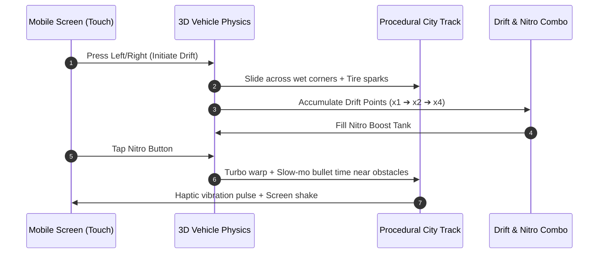

# 🏎️ Cyber Drift 3D: Neon Pursuit — Game Design Document (GDD)

## 1. High Concept & Visual Promise
- **Genre**: 3D Cyberpunk Hyper-Drifter / High-Speed Reflex Arcade
- **Visual Target**: "Real Game Engine 3D" feel. A dark, rain-soaked synthwave metropolis illuminated by dynamic neon lighting, wet asphalt reflections (PBR), tire-smoke particle bursts, and high-speed motion blur.
- **Engine**: Godot 4 (Vulkan Mobile 3D / Forward+)
- **Target Device**: Android (minSdk 24+, Vulkan / OpenGL ES 3.0), verified on physical device `b7a6bfe1`.

---

## 2. Visual Architecture & 3D Engine "Juice"

```
[ Dynamic Skybox / Neon City Silhouette ]
                  |
         [ Volumetric Fog ]
                  |
    +-------------v-------------+
    | Wet Asphalt Highway (PBR) | <--- Real-time Light & Reflection Probes
    +-------------+-------------+
                  |
        [ Cyberpunk 3D Car ]
          ├── Emissive Neon Underglow & Headlights
          ├── GPU Particle Tire Smoke & Drift Sparks
          ├── Dynamic Chase Camera (Dips & tilts on turns)
          └── Turbo Flame Exhaust + Radial Motion Blur
```

### Visual Features
1. **PBR Wet Road Shader**:
   - High metallic, low roughness with normal map puddle ripples to reflect headlights and neon billboards.
2. **Volumetric Lighting & Bloom**:
   - Godot 4 `WorldEnvironment`: Glow/Bloom threshold tuned for emissive neon strips, headlights, and city skyline.
3. **Dynamic 3D Chase Camera**:
   - Low-slung rear camera that dynamically tilts into aggressive drifts, shakes during near-misses, and snaps into wide-angle speed fov when hitting nitro.
4. **Cinematic "Bullet Time" (Slow-Mo)**:
   - Near-misses with traffic or police roadblocks trigger a 0.35s slow-motion freeze with chromatic aberration and bass-drop audio effect.

---

## 3. Core Gameplay Loop



### Controls (Smooth One-Thumb Mobile Driving)
- **Hold Left / Right**: Steer into drift angle. Car automatically maintains forward throttle.
- **Counter-Steer Flick**: Releasing and tapping opposite triggers a snappy, stylish weight-transfer drift.
- **Nitro Tap**: Unleashes instant speed boost that plows through small debris and ramps across highway gaps.

---

## 4. 7-Day Sprint Milestones (For Week 1 Build)

| Day | Milestone | Target Deliverable |
|---|---|---|
| **Day 1** | **Vehicle Physics & Camera Rig** | Godot 4 project with raycast/rigidbody 3D car, drift mechanics, dynamic follow camera. |
| **Day 2** | **Procedural 3D City Track** | Segmented curved highway pieces, tunnel sections, glowing barricades and moving traffic. |
| **Day 3** | **Shaders, Lighting & Post-Processing** | Wet road PBR shader, neon bloom, headlights, fog, and reflective materials. |
| **Day 4** | **3D Particles & VFX** | GPU tire smoke, drift sparks, nitro trail, rain splashes, and camera motion blur. |
| **Day 5** | **Audio & Device Performance Lock** | Synthwave engine loops, tire screech audio, phone haptics, 60 FPS lock on connected phone. |
| **Day 6** | **UI, High Score & Release Packaging** | Retro-futuristic speed HUD, Garage car selector, signed `.aab` + store icon/screenshots. |
| **Day 7** | **Google Play Publishing** | Play Console track upload and public build release. |

---

## 5. Progression & Replayability (Free Zero-Cost Retention)
- **The Garage**:
  - Vehicle 1: *Cyber Sprinter* (Balanced starter)
  - Vehicle 2: *Neon Phantom* (High drift angle & tight cornering)
  - Vehicle 3: *Apex Interceptor* (Heavy armor, max nitro speed)
- **Customization**:
  - Unlockable Neon Underglow: Electric Cyan, Cyberpunk Pink, Toxic Green, Solar Gold.
- **Daily Challenge**:
  - Seeded infinite run with global daily leaderboard.
