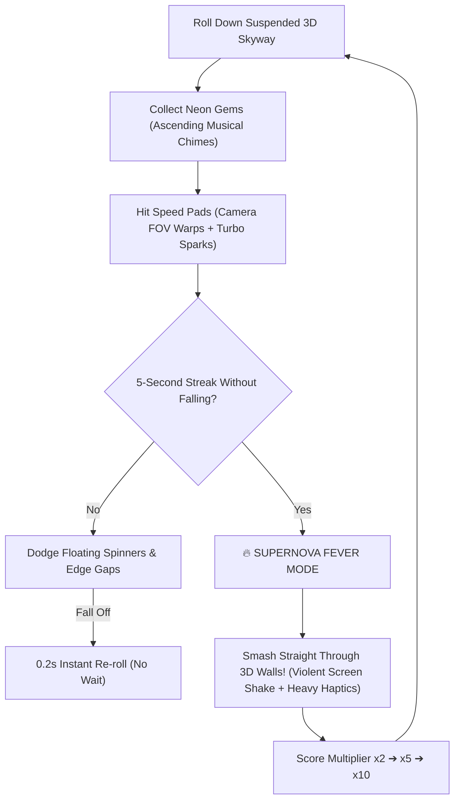

# 🔮 Neon Sky Roller 3D — Flagship Game Plan

## 1. The Core Hook: "Why People Can't Put It Down"
- **Genre**: 3D High-Speed Physics Roller / Flow-State Arcade
- **Control**: **1-Finger Drag** (Slide left/right to steer momentum across suspended sky tracks).
- **Core Psychology**:
  1. **Zero Learning Curve**: Anyone understands it in 2 seconds.
  2. **Escalating Dopamine**: Collecting crystals plays ascending musical notes; hitting speed pads warps the camera FOV with electric particle trails.
  3. **Supernova Fever Mode**: Keep a streak alive to become an invincible flaming comet that **smashes through 3D monoliths into tumbling physics debris** with violent haptic feedback.
  4. **Instant 0.2s Restart**: No loading screens, no menus on death—tap and instantly rolling again. Eliminates exit friction.

---

## 2. Real 3D Engine Eye Candy (Godot 4 Vulkan)

```
        [ Dynamic Sunset Skybox & Volumetric Clouds ]
                              │
                    [ Dynamic Sun Glare ]
                              │
     ┌────────────────────────▼────────────────────────┐
     │ Suspended Sky Highway (Emissive Cyber Grid)      │
     └────────────────────────┬────────────────────────┘
                              │
               [ High-Reflectivity 3D Sphere ]
                 ├── Real-time metallic environment reflection
                 ├── Speed trail + particle vortex
                 ├── Mid-air jump slow-mo camera tilt
                 └── Physics collision with tumbling breakable blocks
```

### Visual Features
- **PBR Materials**: Chrome, obsidian, and neon energy balls reflecting the moving clouds and track lights.
- **Dynamic Camera**:
  - Drops low behind the ball during speed bursts.
  - Zooms out and tilts when launching off sky ramps into the clouds.
  - Radial motion blur and chromatic aberration during Supernova mode.
- **Breakable 3D Physics**:
  - Hitting obstacles in normal mode shatters the ball into physics fragments.
  - Hitting obstacles in Supernova mode pulverizes the barrier into hundreds of glowing 3D pieces that tumble off into the sky.

---

## 3. Core Gameplay Loop



---

## 4. 7-Day Production Plan (Ready for Play Store Release)

| Day | Focus | What Gets Built |
|---|---|---|
| **Day 1 (Mon)** | **Physics Ball & 1-Finger Touch** | Responsive rolling sphere with inertia, banking turn tilt, smooth 1-finger drag input. |
| **Day 2 (Tue)** | **Modular Sky Track System** | Straightaways, S-curves, banked ramps, moving barriers, and bottomless drops. |
| **Day 3 (Wed)** | **Visuals & Vulkan 3D Shaders** | Chrome PBR ball, glowing track edge lines, volumetric cloud horizon, bloom lighting. |
| **Day 4 (Thu)** | **Supernova Fever & Destruction** | Combo meter, invincible fire mode, 3D breakable physics blocks, screen shake & FOV zoom. |
| **Day 5 (Fri)** | **Sensory Polish & Device Test** | Musical crystal chimes, heavy roll rumble on phone (`b7a6bfe1`), 60 FPS lock check. |
| **Day 6 (Sat)** | **Skins, HUD & Store Assets** | 6 unlockable 3D spheres (Cyber, Magma, Gold, Plasma), 3D icon render, signed `.aab`. |
| **Day 7 (Sun)** | **Google Play Console Release** | Publish to Google Play closed/open track; gather feedback for Week 2 track expansion. |

---

## 5. Free Progression System (High Retention)
- **Crystals = Unlocks**: Every gem collected feeds the Garage:
  - Ball 1: *Cyber Neon* (Default glowing blue)
  - Ball 2: *Liquid Chrome* (High-reflectivity mirror surface)
  - Ball 3: *Solar Core* (Sun flares + fire particles)
  - Ball 4: *Dark Matter* (Black hole vortex effect)
- **Distance Milestones**: Checkpoints at 500m, 1,000m, 2,500m unlock new sky themes (Sunset Horizon ➔ Cyber Midnight ➔ Aurora Borealis).
