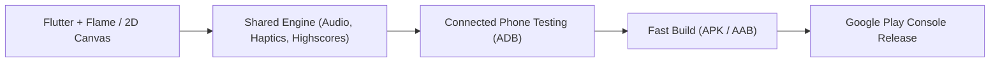
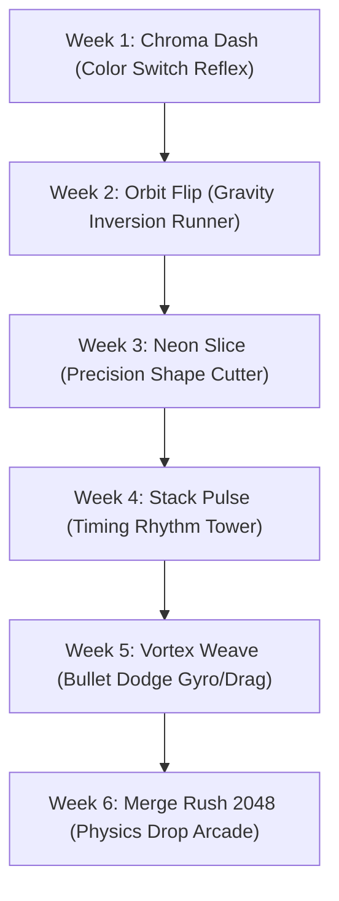

# 🚀 Android Games Studio: Master Strategy & Roadmap

## 1. Overview & Goals
- **Mission**: Build, polish, and publish high-engagement, hyper-casual Android games on a **weekly cadence** with zero budget.
- **Workflow**: 7-day micro-sprints from concept to signed `.aab` release.
- **Hardware Integration**: Live debugging and hot-reloading on connected Android phone (`b7a6bfe1`).
- **Repository**: [github.com/dhayalramk/android_games](https://github.com/dhayalramk/android_games)

---

## 2. Tech Stack & Zero-Cost Pipeline



### Why Flutter + Flame / 2D Canvas?
1. **Free & Open Source**: No royalties, subscriptions, or license seats.
2. **Lightning-Fast Iteration**: Stateful hot reload directly to the connected phone in `<1s`.
3. **Lightweight Builds**: Minimal APK size (~15MB-25MB), fast downloads for mobile users.
4. **Rich UI & Juice**: Native access to mobile haptic engines (`vibrate`), high-resolution canvas painting, particle systems, and audio synthesis.

---

## 3. The 7-Day Game Sprint Playbook

| Day | Phase | Deliverable | Action Items |
|---|---|---|---|
| **Mon** | **Day 1: Concept & Core Loop** | Playable Graybox | Implement single core touch mechanic (tap, swipe, hold). Verify fun factor within 30 seconds. |
| **Tue** | **Day 2: Physics & Difficulty** | Core Gameplay Loop | Collision detection, score multiplier, dynamic speed/procedural difficulty curve. |
| **Wed** | **Day 3: "Juice" & Visual Polish** | High Aesthetic Finish | Screen shake, neon/flat color palettes, particle bursts on impact, trail effects. |
| **Thu** | **Day 4: Audio, Haptics & UI** | Sensory Feedback | Royalty-free micro sound FX (pops, chimes, whooshes), tactile haptic feedback, Pause/Game Over dialogs. |
| **Fri** | **Day 5: Real-Device Testing** | 60+ FPS Device Lock | Test directly on connected phone via ADB, fix edge cases (notches, aspect ratios, battery drain). |
| **Sat** | **Day 6: Store Packaging** | Signed `.aab` + Assets | App icon (512x512), Feature Graphic (1024x500), 3 screenshots, signed release bundle. |
| **Sun** | **Day 7: Launch & Review** | Google Play Track | Upload to Internal/Closed or Production track on Play Console; log metrics for Week 2 update. |

---

## 4. Proposed First Game: **Chroma Dash (Color Rush)**

### 💡 Core Concept
A hypnotic, rhythm-infused, hyper-casual reflex runner where your character's color is constantly tested against oncoming laser barriers.

```
       [Wall: Blue]         [Wall: Yellow]
            |                     |
            v                     v
   ---[Blue Barrier]-------[Yellow Barrier]---
            ^
            |
    [ Player: BLUE ]   <-- (Tap screen to switch: Blue ➔ Red ➔ Yellow)
```

### 🎮 Gameplay Mechanics
- **One-Tap Control**: Tapping anywhere cycles your player orb through 3 vibrant neon colors (**Cyan**, **Magenta**, **Yellow**).
- **Matching Rule**: Pass through barriers of your **matching color** to shatter them into glowing particles and earn combo points.
- **Instant Death**: Hitting a mismatched color barrier ends the run.
- **Fever Mode**: 10 consecutive perfect passes triggers "Hyper Dash" for 5 seconds—invincibility where you blast through all colors with intense neon trails and screen shake.

### 🌟 Why This Game for Week 1?
1. **Addictive Replay Loop**: Rounds last between 15 and 90 seconds. "Just one more try" psychology.
2. **Minimal Asset Overhead**: Requires zero 3D models or complex animations; looks stunning with geometric shapes, glow shaders, and particle bursts.
3. **Perfect Device Stress Test**: Tests touch latency, smooth 60fps rendering, and responsive haptic vibrations on the physical phone.

---

## 5. Upcoming 6-Week Game Pipeline



---

## 6. Shared Reusable Modules (Build Once, Reuse Always)

To keep game production under 1 week, we create shared modules under `/shared`:
1. **`shared_audio`**: Lightweight sound manager for sound effects (synth bleeps, explosion pops) and background music with mute toggle.
2. **`shared_haptics`**: Tactile feedback presets (light tap on score, medium impact on shield break, heavy pulse on game over).
3. **`shared_storage`**: High score persistence, sound preference toggles, and total games played tracking using local storage.
4. **`shared_ui`**: Ready-to-use HUD, Pause overlay, High Score crown, Game Over card with restart button.
