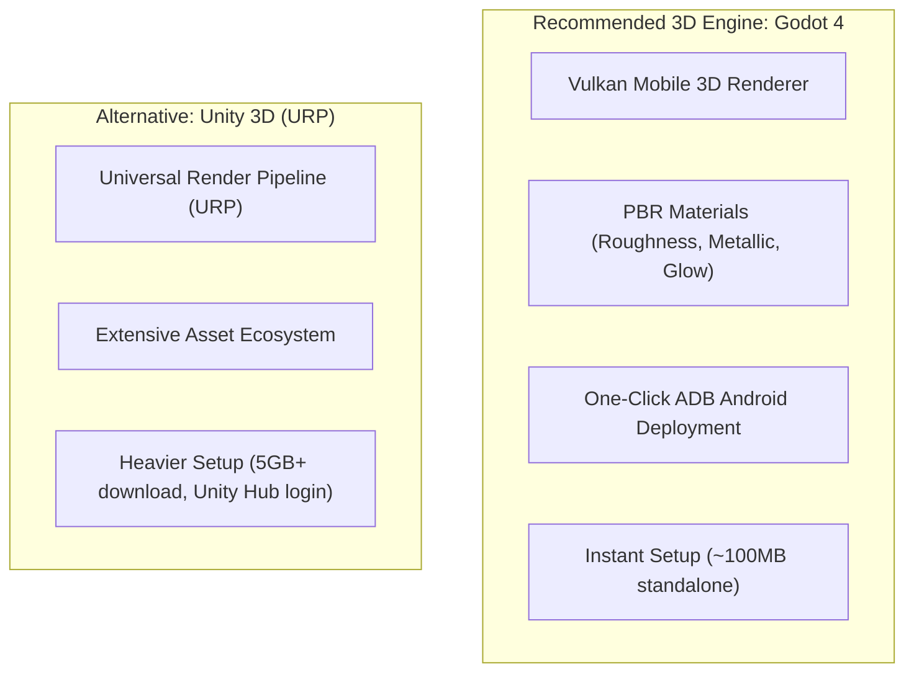

# 🚀 3D Android Games Studio: Master Plan & Visual Strategy

## 1. High-Fidelity 3D Vision
- **Goal**: Build immersive, visually stunning **Full 3D** Android games with real game engine aesthetics—dynamic lighting, PBR materials, post-processing (bloom, depth of field), 3D physics, and particle effects.
- **Visual Impact**: Looks like a polished commercial title on Google Play, avoiding simplistic 2D or flat prototypes.
- **Workflow**: Weekly sprints targeting rapid prototyping, physical device testing (`b7a6bfe1`), and Play Store releases.
- **Repository**: [github.com/dhayalramk/android_games](https://github.com/dhayalramk/android_games)

---

## 2. 3D Game Engine Options (Free & High Performance)

### Recommendation: **Godot 4 (Vulkan Mobile 3D)**
- **Why**: 100% free and open-source (MIT license, zero royalties or subscription locks).
- **Vulkan Mobile Renderer**: High-end modern mobile visuals (real-time shadows, bloom/glow, screen-space reflections, volumetric fog, particle shaders).
- **Instant Deploy**: Direct one-click run on your connected Android phone via ADB in seconds.

---

## 3. High-Attraction 3D Game Concepts

### 🏎️ Option A: **Cyber Drift 3D (Neon Pursuit)**
- **Look & Feel**: Sleek stylized sports car drifting through a rain-slicked cyberpunk metropolis. Wet asphalt reflecting neon streetlights, glowing brake calipers, tire smoke particle trails, motion blur, and cinematic camera follow.
- **Core Loop**: One-thumb drifting around tight corners, collecting boost cores, dodging oncoming traffic and police barricades. Near-misses trigger slow-motion "Bullet Time" with screen distortion.
- **Attraction Factor**: ★★★★★ (High adrenaline, premium 3D vehicle physics and lighting).

---

### 🔮 Option B: **Sphere Odyssey 3D (Sky Roller)**
- **Look & Feel**: Inspired by hits like *Rolling Sky* and *Going Balls*. A reflective chrome / energy sphere rolling across intricate sky tracks suspended over a volumetric cloud sea.
- **Core Loop**: Intuitive swipe/tilt controls with momentum and physics. Dodge swinging 3D pendulums, jump ramps with slow-mo airtime, activate speed boosters, and smash through destructible crystal gates.
- **Attraction Factor**: ★★★★★ (Extremely satisfying 3D rolling physics, gorgeous skyboxes, and scale).

---

### 💎 Option C: **Glass Shatter 3D (Surreal Strike)**
- **Look & Feel**: Inspired by *Smash Hit*. Moving through a surreal dreamscape of glass monoliths and moving geometric obstacles in a futuristic tunnel.
- **Core Loop**: Tap to launch heavy steel spheres to smash through crystal barriers and glass panes with realistic 3D fracture physics and spatial audio.
- **Attraction Factor**: ★★★★★ (Hypnotic destruction physics, crystal clarity shaders, spatial sound).

---

## 4. 7-Day 3D Sprint Production Pipeline

| Day | Focus | Output |
|---|---|---|
| **Mon** | **3D World & Camera Controller** | 3D stage, responsive player controller, camera rig with dynamic tilt |
| **Tue** | **3D Physics & Obstacle Spawning** | Rigidbody collisions, procedural track/obstacle generation |
| **Wed** | **Visual Fidelity & Shaders** | PBR materials (metallic/roughness), WorldEnvironment (Bloom, Glow, Tonemapping), lighting |
| **Thu** | **Particles & "Juice"** | 3D GPUParticles (sparks, smoke, speed lines), camera shake, hit stop |
| **Fri** | **Audio, Haptics & Optimization** | 3D positional audio, phone vibration feedback, 60 FPS lock on device via ADB |
| **Sat** | **Packaging & Store Assets** | 3D rendered high-res icon & screenshots, signed release `.aab` |
| **Sun** | **Publish & Iterate** | Google Play upload & plan week 2 additions |
